<!-- Shazan · Mohammad Taha · Full-Stack Developer · TypeScript · Python · Next.js · FastAPI · Chandigarh University -->

  
  
  
  

  

<picture>
  <source media="(prefers-color-scheme: dark)" srcset="./assets/terminal-dark.svg" />
  <source media="(prefers-color-scheme: light)" srcset="./assets/terminal-light.svg" />
  
</picture>

## 🪽 About me

I'm **Mohammad Taha** — **Shazan** online — a **full-stack developer** and Computer Science & Engineering student at **Chandigarh University**. I build web apps end to end: data models, validation, auth, tests and deploys, mostly in **TypeScript** and **Python**.

One rule shows up in everything I build: **the part that guesses is kept apart from the part that decides.** AI can draft; deterministic code checks, runs and approves.

- 🚀 Co-founder of **[NAVNA](https://navna.online)**, a web & technology agency
- 🧪 Building **[Lab-Forge](https://github.com/SHZunknown11/Lab-Forge)** — upload an experiment sheet, get a finished lab report with code that was actually run
- 🎥 Ex-YouTuber (1.3K+ subscribers), language teacher and community founder
- 🤝 Open to **internships** and **collaborative projects** — remote, hybrid or on-site

## ⚡ Featured work

| Project | What it does | Stack |
|---|---|---|
| **[Lab-Forge](https://github.com/SHZunknown11/Lab-Forge)** · [live](https://labforge-e9yk.onrender.com/) | Experiment sheet → finished lab report. Every generated program is compiled and run; output that can't be produced is marked *not run*, never made up. | Python · FastAPI · React · Docker · Gemini |
| **[AlgoDraft](https://ai-trading-4xa.pages.dev/)** | Plain-English trading strategy → validated spec → demo-only MetaTrader 5 Expert Advisor. A deterministic validator decides what's allowed. | FastAPI · React · MQL5 · Postgres |
| **[Property Tricity Live](https://property-tricity-live.onrender.com/)** | Regional property media with role-based publishing: 22 permissions, hardened auth, login throttling. | Next.js · Prisma · Postgres · Turnstile |
| **Kartar Aarogyam** | Virtual OPD booking and a secure admin dashboard for a wellness centre. Server re-validates with Zod, same-origin checks, rate limits. | Next.js · Cloudflare Workers · D1 · Drizzle |
| **[Mochi Kitchen](https://github.com/SHZunknown11/mochi-kitchen)** · [live](https://mochi-kitchen.mochi-kitchen.workers.dev/) | A cute AI recipe finder: NLP + TheMealDB + Gemini. | Node · Hono · Cloudflare Workers · D1 |
| **[Smart Irrigation](https://github.com/SHZunknown11/smart-irrigation-system-iot)** | ESP8266 irrigation controller with a cooldown so one bad sensor reading can't flood the pot. | C++ · ESP8266 · Blynk |

More on the <a href="https://mohammad-taha-portfolio.pages.dev">portfolio</a>: Parru Dutt Estate, NAVNA site, Vibe.cast, QuizMaster Pro and more.

## 🛠️ Tech stack

   
   
  

## 💼 Experience

- **Co-founder** · NAVNA — web & technology agency · *2026 – now*
- **Project Manager** (part-time, remote) · CognitechAI · *Apr – Oct 2025* — planned corporate training projects, designed e-learning content
- **Founder & administrator** · English Club · *2022 – 2024*
- **Content creator** · YouTube · *2020 – 2024* — 1.3K+ subscribers
- **B.E. Computer Science & Engineering** · Chandigarh University · *2024 – 2028*

## 📈 GitHub activity

  

  

**Let's build something.** → [LinkedIn](https://www.linkedin.com/in/mohammad-taha11/) · [Portfolio](https://mohammad-taha-portfolio.pages.dev) · [Telegram](https://t.me/SHZunknown11)

